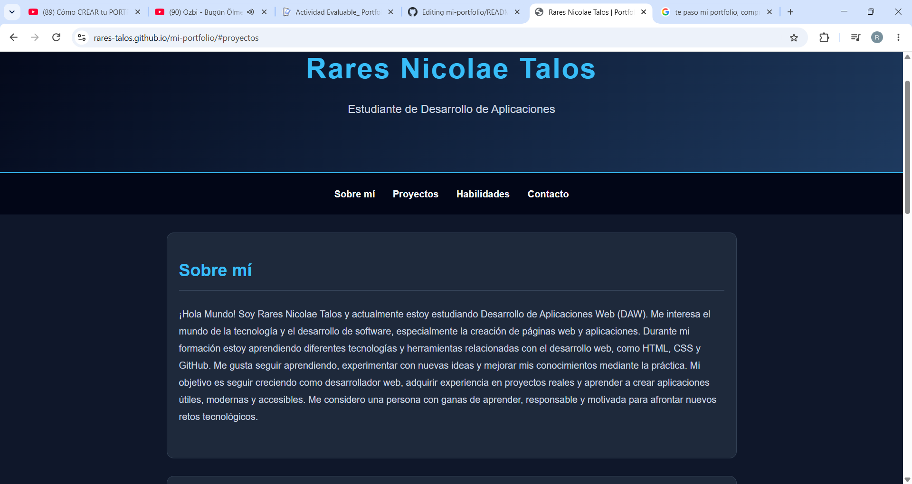

# Portfolio Personal - Rares Nicolae Talos

Página web personal desarrollada como proyecto práctico en el ciclo de **Desarrollo de Aplicaciones Web (DAW)**. 
La página contiene una breve presentación sobre mí, una serie de proyectos académicos, mis habilidades técnicas y personales, y modos de contacto. 
Todo el contenido tiene un diseño moderno y responsive.

🌐 **Enlace a la página publicada:** https://rares-talos.github.io/mi-portfolio/

## 🛠️ Tecnologías utilizadas

* **HTML5:** Estructura semántica de la web (`header`, `nav`, `main`, `section`, `article`, `footer`).
* **CSS3:** Diseño personalizado en modo oscuro, Grid, Flexbox, efectos *hover*, *scroll* suave y diseño *responsive* mediante *media queries*.
* **Git y GitHub:** Control de versiones y gestión del repositorio.
* **GitHub Pages:** Alojamiento y despliegue gratuito del sitio web.

## 📂 Estructura del proyecto

* `index.html`: Página principal con todas las secciones del portfolio.
* `css/style.css`: Hoja de estilos personalizada y adaptable a móviles.
* `README.md`: Documentación descriptiva del proyecto.

## 📸 Vista previa

